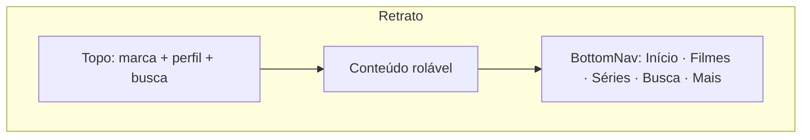

# RFC 0023: Celular e tablet em pé (retrato), com navegação inferior e toque
- **Status:** Rascunho
- **Autor:** Eduardo
- **Data:** 2026-11-03

## Contexto e problema
O app nasceu para TV e hoje só funciona deitado:

- `android/app/src/main/AndroidManifest.xml` trava a Activity em `screenOrientation="landscape"`.
- A escala é `html { font-size: calc(100vw / 120) }` (`src/style.css`), e no celular `100vw / 80`. Em pé, a largura é
  ~390 px, então 1 rem dá ~5 px: tudo fica minúsculo e sobra meia tela vazia embaixo (conferido no navegador em
  390×844 e 800×1280).
- A navegação é a da TV: menu lateral (`SideMenu.vue`), foco por D-pad (`spatialNavigation.js`), fileiras
  horizontais com setas.
- **Android 16 (targetSdk 36, já exigido pela Play) ignora a trava de orientação em telas com 600 dp ou mais**
  (tablets e dobráveis). Mesmo sem fazer nada, nesses aparelhos o app já abre em pé, quebrado. A revisão da Play
  avalia telas grandes.

Decisão do dono (2026-11-03): fazer a experiência completa em pé no celular, "se vamos fazer, vamos fazer direito".

## Objetivos / Não-objetivos
**Objetivos**
- Celular em pé com layout próprio: barra de navegação embaixo, fileiras e grades no tamanho do dedo, detalhes em tela
  cheia, busca, perfis, listas e ativação usáveis com uma mão.
- Celular deitado continua como está hoje (já aprovado).
- Tablet em pé (exigência do Android 16) usa o mesmo layout em pé, com mais colunas.
- Player sempre deitado: ao dar play, gira para deitado; ao fechar, volta para a orientação livre.
- TV (Tizen, webOS, Android TV) **sem nenhuma mudança visual**: layout, foco e testes de TV ficam iguais.

**Não-objetivos**
- iOS / iPhone (não há projeto iOS).
- Player em pé (vídeo em retrato). Fica para depois, se houver pedido.
- Redesenho do celular deitado ou da TV (isso é a RFC-014).
- Gestos avançados (puxar para atualizar, arrastar o player para minimizar).

## Proposta

### 1. Forma do aparelho, num lugar só
Novo `src/composables/useFormFactor.js`, a única fonte da verdade, reativo via `matchMedia('(orientation: portrait)')`:

| Valor | Quando |
|---|---|
| `tv` | não é toque (regra atual de `isPhone` em `src/utils/compat.js`: TV não tem `maxTouchPoints`) |
| `handheld-landscape` | celular ou tablet com toque, deitado (layout de hoje) |
| `handheld-portrait` | celular ou tablet com toque, em pé (**novo**) |

- `isPhone()` em `compat.js` passa a incluir o tablet (toque + Android, sem exigir "Mobile" no User-Agent), então
  `html.is-phone` e a variante `phone:` valem para os dois. É o que a decisão "tablet deitado = celular deitado" pede,
  sem uma segunda classe. (Onde este texto diz `is-handheld`, leia `is-phone`.)
- Regra fixa do projeto mantida: **nunca decidir por largura**, porque TVs Android de 960 px pegariam a regra.
  Retrato só com `is-handheld`.

### 2. Escala e variantes CSS
`src/style.css`:
```css
@media (orientation: portrait) {
  html.is-handheld { font-size: calc(100vw / 25); }   /* 390 px → 1rem ≈ 15,6 px */
}
@media (orientation: portrait) and (min-width: 600px) {
  html.is-handheld { font-size: calc(100vw / 45); }   /* tablet 800 px → ≈ 17,8 px */
}
```
- `tailwind.config.js` ganha a variante `phone-portrait:`, que é `@media (orientation: portrait) { html.is-phone & }`
  (o `portrait:` nativo do Tailwind pegaria qualquer tela em pé).
- As telas usam `phone-portrait:` para ajustes pequenos (espaçamentos, colunas). A troca de estrutura (menu lateral → barra
  inferior) é feita por `v-if` com `useFormFactor`.

### 3. Estrutura em pé

- **`src/components/BottomNav.vue` (novo)**
  - Emite o mesmo `navigate(tab)` do `SideMenu`.
  - "Mais" abre uma folha com Canais ao vivo, Listas, Enviar lista pelo site, Trocar perfil, Ativação, Ajuda e Sair.
  - Respeita a área segura (`env(safe-area-inset-bottom)`).
  - Mostrado só em `handheld-portrait`. O `SideMenu` continua em TV e deitado.
- **`Dashboard.vue` (Início)**
  - Destaque no topo com a imagem em largura total, título e botões "Assistir" e "Detalhes" lado a lado.
  - As fileiras ficam abaixo, rolando a página na vertical.
  - Cartões: `w-36` (pôster) e `w-64` (canal).
- **`CatalogBrowser.vue` / `GridView.vue`**
  - Grade de 3 colunas no celular e 5 no tablet.
  - As categorias (chips) viram uma faixa horizontal rolável fixa no topo.
- **`MediaDetailsModal.vue`**
  - Tela cheia, com a imagem no topo e o conteúdo rolando.
  - Temporadas em chips; episódios em lista de uma coluna.
- **`SearchScreen.vue`**
  - Campo no topo, com o teclado do sistema e não o teclado da TV.
  - Resultados em grade de 3 colunas.
- **`Login.vue`, `ListManagerModal.vue`, `FTUE.vue`, `ProfileGate.vue`, `ActivationRequired.vue`**
  - Uma coluna e botões em largura total.
  - No `ActivationRequired`, o QR some e no lugar entra o botão "Abrir página de planos" (não faz sentido ler um
    QR no próprio celular).

### 4. Toque
- O anel de foco da TV fica escondido em `is-handheld` com toque. Quem navega por teclado continua vendo o foco
  (`:focus-visible`).
- As setas das fileiras já somem em `phone:`; em retrato, a rolagem é por arrasto (`overflow-x: auto` + `snap`, que
  já existe).
- Alvo de toque mínimo de 44 px: a regra já existe em `html.is-phone button`; ela passa a valer para `is-handheld`.
- Voltar: o botão e o gesto do Android já passam por `registerBackHandler`; nada muda.

### 5. Orientação no Android
- `AndroidManifest.xml`: `screenOrientation="fullUser"`.
- `MainActivity.java`: em TV (`UiModeManager.getCurrentModeType() == UI_MODE_TYPE_TELEVISION`), chama
  `setRequestedOrientation(SCREEN_ORIENTATION_LANDSCAPE)` em `onCreate`. A TV fica como hoje.
- Player: um método novo no plugin nativo que já existe (`PictureInPicturePlugin.java` vira um "plugin do player"),
  chamado por `src/services/platform.js`:
  - `lockLandscape()`: `SENSOR_LANDSCAPE` ao abrir o vídeo;
  - `unlockOrientation()`: `FULL_USER` ao fechar.
  - Não usa `import()` dinâmico novo; registro via `registerPlugin`, como hoje.
- No navegador do celular (PWA ou testes), o `screen.orientation.lock('landscape')` só funciona em tela cheia, então
  é tentado e o erro é ignorado.

### 6. Aprovação visual antes do código
`docs/design-2.0/mockups-celular.html`, no mesmo formato de `mockups.html`: Início, Filmes, Detalhes de série, Busca,
Mais e Login em 390×844, mais o Início em tablet 800×1280. O código só começa depois do OK do dono.

## Alternativas consideradas
- **Manter travado deitado e só "não quebrar" no tablet.** Rápido, mas o dono pediu a experiência completa. Também
  não resolve o uso com uma mão, que é o normal no celular. Descartada por decisão do dono.
- **Projeto separado para o celular** (outra pasta ou outro app). Duplicaria serviços, stores e player, e cada
  correção precisaria ser feita duas vezes. Descartada (ver a conversa de 2026-11-03 sobre os três projetos).
- **Decidir o retrato por largura (`max-width`).** Pegaria TVs Android pequenas e janelas estreitas no PC. Descartada:
  regra fixa do projeto.
- **Plugin oficial `@capacitor/screen-orientation`.** Funciona, mas é mais uma dependência nativa para dois métodos; o
  plugin próprio já existe e já tem testes (`tests/androidPip.test.js`). Fica como plano B.

## Riscos e mitigação
| Risco | Mitigação |
|---|---|
| Quebrar a TV sem perceber | Toda regra nova fica atrás de `is-handheld` + retrato; os testes de TV (`tvStyles`, `tvCompat`, `spatialNavigation`) seguem iguais e verdes; `__pulse.audit()` em TV antes de cada entrega |
| Dashboard.vue com 1.044 linhas fica ainda maior | Destaque e fileiras em retrato viram componentes próprios (`HomePortrait.vue`), em vez de `v-if` espalhado |
| Celular fraco engasgar com fileiras longas | Reaproveitar a leitura item a item e o `HorizontalRail` do commit `4f0e8e1`; cartões em retrato carregam a imagem menor |
| Teclado do sistema cobre o campo da busca | `scrollIntoView` no foco e `adjustResize` (já é o padrão do Capacitor) |
| Rotação no meio do vídeo | O player trava deitado; ao fechar, solta |

## Plano de implementação
Cada etapa termina com lint, testes e build verdes e é entregue separada.

1. **Mockups** (`docs/design-2.0/mockups-celular.html`) e aprovação do dono.
2. **Base:** `useFormFactor`, `is-handheld`, escala em retrato, variante `portrait:`, testes de `compat` e da escala.
3. **Orientação nativa:** manifesto, `MainActivity`, trava do player e teste no APK do CI (TV continua deitada).
4. **Navegação:** `BottomNav` e folha "Mais"; `Dashboard` troca `SideMenu` por `BottomNav` em retrato.
5. **Início em retrato** (`HomePortrait.vue`).
6. **Filmes, Séries e Ao vivo** (grade e chips).
7. **Detalhes e episódios.**
8. **Busca.**
9. **Login, Listas, Perfis, FTUE e Ativação** em uma coluna.
10. **Tablet em pé:** colunas a mais e conferência em 800×1280.
11. **Teste no celular real** (APK do CI) e ajustes.

## Decisões do dono (2026-11-03)
- Tablet **deitado** usa o layout do celular deitado (o de hoje).
- Barra inferior: **Início · Filmes · Séries · Busca · Mais** (opção B dos mockups). Os canais ao vivo viram uma
  fileira "Canais ao vivo" no Início (com "Ver todos") e um item "Canais ao vivo" no Mais.
- **O site do QR precisa estar a um toque no celular.** Na TV, o QR leva ao site (enviar lista e assinar); no celular,
  o mesmo caminho vira botão:
  - Login: "Enviar a lista pelo site" abre `<site>/?codigo=<código>` no navegador do sistema; a lista chega cifrada
    pela caixa de entrada (RFC-021) e o app pede a confirmação de sempre (`SiteInboxPrompt`).
  - Ativação: "Ver planos e ativar" abre `<site>/a/<código>` (o mesmo endereço do QR).
  - Mais: item "Enviar lista pelo site".
  - O site (`server/license/public/site/site.js`) passa a preencher o campo `code` da página inicial com `?codigo=`,
    como já faz na aba Assinar.

## Perguntas em aberto
1. Canais ao vivo: abrir direto no player deitado ou mostrar antes a "próxima programação" em pé?
