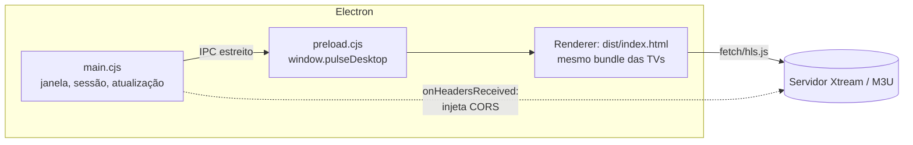

# RFC 0024: App de PC instalável (Windows) com Electron
- **Status:** Rascunho
- **Autor:** Eduardo
- **Data:** 2026-11-03

## Contexto e problema
No navegador do PC o app só funciona em `npm run dev`, por causa do proxy local (`scripts/dev-cors-proxy.mjs`,
`/__proxy__`). Publicado como site, ele quebra por dois motivos:

1. **CORS:** quase nenhum servidor Xtream manda `Access-Control-Allow-Origin`, então o navegador não deixa ler
   `player_api.php`, `get.php`, `.m3u` e `.m3u8`.
2. **Conteúdo misto:** um site em `https` não pode buscar vídeo `http`, e quase todas as listas são `http`.

O APK resolve os dois no nativo (`MainActivity.shouldInterceptRequest` refaz as chamadas pelo `HttpURLConnection`),
e Tizen/webOS carregam por `file://`, onde o CORS não se aplica do mesmo jeito. Decisão do dono (2026-11-03): PC como
**app instalável**, e não como site com proxy.

## Objetivos / Não-objetivos
**Objetivos**
- Instalador para Windows 10/11 (x64), reaproveitando 100% do `src/` e o mesmo `npm run build`.
- Listas e vídeos `http`/`https` sem CORS, como no APK.
- Publicação na **Microsoft Store** (MSIX) e um instalador direto (`.exe`) no GitHub Releases.
- Licença (RFC-018) funcionando, com ID do aparelho estável entre reinstalações.
- Atualização automática no instalador direto; na loja, quem atualiza é a própria Store.

**Não-objetivos**
- macOS e Linux (a mesma base serve depois; fica para outra RFC).
- Versão site/PWA para PC.
- Player nativo (mpv/VLC) para codecs que o Chromium não toca (E-AC3, por exemplo): fica para a decisão do item
  "Vídeo" do `docs/PLANO.md`.

## Proposta

### Arquitetura

### Arquivos novos (`desktop/`)
- `desktop/main.cjs`
  - Cria a `BrowserWindow` (1280×720, mínimo 960×540, fundo `#0b0f0c`, sem menu) e carrega `dist/index.html` por
    `file://`.
  - O build já é um script clássico único para `file://`, por causa das TVs (`vite.config.js`). Nada muda no Vite.
- `desktop/preload.cjs`
  - Expõe só `window.pulseDesktop = { platform: 'desktop', machineId(), exit(), setFullscreen(on), onBackground(cb) }`
    via `contextBridge`.
- `desktop/electron-builder.yml`: alvos `nsis` (instalador direto) e `appx` (Microsoft Store), `appId`
  `com.pulseplayer.app`, ícones de `npm run icons`.
- `package.json`: scripts `desktop:dev` (Vite + Electron) e `desktop:build` (`vite build && electron-builder`).
  `electron`, `electron-builder` e `electron-updater` entram como devDependencies.

### Sem CORS, como no APK
Em `main.cjs`, numa sessão própria (`partition: 'persist:pulse'`):
- `session.webRequest.onHeadersReceived`: em respostas `http`/`https` vindas de `file://`, acrescenta
  `Access-Control-Allow-Origin: *` e `Access-Control-Allow-Headers: *`, e expõe `Content-Length` e `Content-Range`.
- Requisições `OPTIONS` de preflight recebem 204 na hora (`onBeforeRequest` + resposta sintética via
  `protocol.handle`).
- Página em `file://` não é `https`, então não existe bloqueio de conteúdo misto, e `crypto.subtle` continua
  disponível (`file:` conta como contexto seguro no Chromium).
- **Não** usar `webSecurity: false`: isso desligaria a política de mesma origem para tudo, inclusive a página.

### Integração com o app (mudanças pequenas)
| Arquivo | Mudança |
|---|---|
| `src/services/netEnv.js` | `isDesktopApp()` = `!!window.pulseDesktop`; nesse caso `canUseDevProxy()` é `false`, como no APK |
| `src/services/platform.js` | `exitApp`/`canExitApp` usam `pulseDesktop.exit()`; `onAppBackground` fica sem aviso, como no PC hoje (minimizar não pausa) |
| `src/services/deviceIdentity.js` | plataforma `desktop`; chave = hash SHA-256 do `MachineGuid` do Windows (lido no `main.cjs` e entregue pelo preload); o ID cru nunca sai do PC (mesma regra G3 do Android) |
| `server/license/license-core.mjs` | `PLATFORMS` ganha `'desktop'` |
| `src/utils/compat.js` | `html.is-desktop` para ajustes de mouse (hover nas fileiras, que já existe) |

Teclado e mouse já funcionam: as setas usam a navegação de TV e o mouse usa o hover que já existe no
`CatalogBrowser`. `F11` e duplo clique no player alternam a tela cheia pelo `setFullscreen`.

### Segurança da janela
- `contextIsolation: true`, `sandbox: true`, `nodeIntegration: false`.
- Preload mínimo, sem `ipcRenderer` exposto.
- `will-navigate` e `setWindowOpenHandler`: links externos (WhatsApp, página de planos) abrem no navegador do
  sistema; a janela nunca sai do `file://` do app.
- CSP no `index.html` só no build de desktop: `default-src 'self' file:; connect-src * ; media-src * blob:; img-src * data: blob:`.

### Publicação
- **Microsoft Store:**
  - Conta de desenvolvedor no Partner Center, criada pelo dono.
  - O pacote MSIX gerado pelo `electron-builder` é assinado pela própria Store.
  - Build com `VITE_LICENSE_STORE_BUILD=1`, sem preço na tela de bloqueio, como nas outras lojas.
  - Textos e classificação reaproveitam `docs/lojas/PUBLICACAO.md`.
- **Instalador direto:**
  - NSIS no GitHub Releases, com atualização pelo `electron-updater`.
  - Sem certificado de assinatura de código, o Windows SmartScreen avisa "aplicativo não reconhecido". Comprar um
    certificado (OV/EV) é decisão do dono.
- **CI:** `.github/workflows/build-desktop.yml` em `windows-latest`. Roda lint, testes e `desktop:build`, e anexa o
  `.exe` e o `.appx` como artefatos.

## Alternativas consideradas
- **Site/PWA com proxy no servidor.** Leve para o usuário, mas todo o vídeo passa pelo servidor do dono: custo de banda
  e exposição jurídica como intermediário do conteúdo. Descartada pelo dono.
- **Tauri (WebView2).** Instalador de ~10 MB, mas o WebView2 não deixa reescrever cabeçalhos CORS das requisições
  `fetch` e XHR do hls.js. Seria preciso um proxy por protocolo próprio em Rust para listas e segmentos: mais código
  nativo para manter e outra linguagem no projeto. Fica como opção se o tamanho do Electron virar problema.
- **Electron com `webSecurity: false`.** Uma linha resolve o CORS, mas desliga a proteção de origem da página
  inteira. Descartada por segurança.
- **Proxy local dentro do Electron (servidor http em 127.0.0.1, como o `dev-cors-proxy`).** Funciona, mas abre uma
  porta na máquina e soma latência em cada segmento. A injeção de cabeçalhos é mais simples.

## Riscos e mitigação
| Risco | Mitigação |
|---|---|
| Instalador grande (~90 MB) | Aceito pelo dono; sem `asar` desnecessário; só x64 |
| Codecs que o Chromium não toca (E-AC3/AC3) | Mesmo comportamento do navegador; mensagem de erro clara no player; player nativo fica para outra decisão |
| SmartScreen assusta no instalador direto | Priorizar a Microsoft Store; certificado é decisão do dono |
| Servidor que exige `Referer`/`User-Agent` específico | `onBeforeSendHeaders` pode ajustar por lista no futuro; fora do escopo inicial |
| Reset do teste de 7 dias reinstalando | ID pelo `MachineGuid`, que sobrevive à reinstalação; o limite de aparelhos novos por rede (D1) continua valendo |
| Segurança do Electron desatualizado | Dependabot no `electron`; atualização automática entrega a correção |

## Plano de implementação
1. **Esqueleto** `desktop/` (janela, `file://`, preload mínimo) e `desktop:dev` abrindo o app.
2. **CORS:** injeção de cabeçalhos + preflight; teste com `npm run mock` e com uma lista M3U `http` real.
3. **Integração:** `netEnv`, `platform`, `deviceIdentity`, `'desktop'` no servidor e testes (Vitest) de cada um.
4. **Segurança da janela:** navegação bloqueada, links externos e CSP do build de desktop.
5. **Empacotamento:** `electron-builder` com NSIS e AppX, ícones e workflow `build-desktop.yml`.
6. **Atualização automática** pelo GitHub Releases (só no NSIS).
7. **Microsoft Store:** conta, ficha da loja e envio (dono + IA).

## Decisões do dono (2026-11-03)
- **Só Microsoft Store**, por ser mais seguro: a Store assina o pacote e entrega as atualizações. Saem do plano o
  instalador NSIS, o `electron-updater` e o certificado de assinatura (etapa 6 cancelada; alvo único `appx`). Como só
  existe a versão da loja, a tela de ativação segue a regra das lojas (`VITE_LICENSE_STORE_BUILD=1`).
- **macOS fica de fora.**

## Perguntas em aberto
Nenhuma por enquanto.
