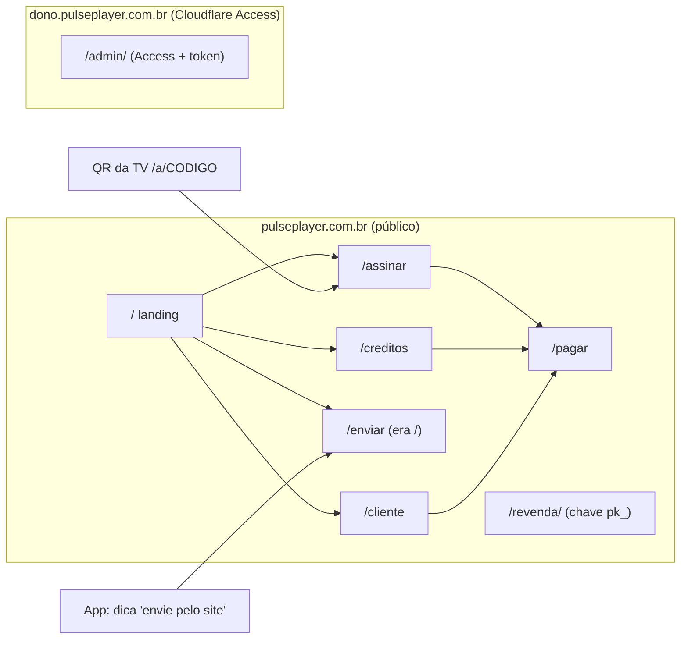

# RFC 0025: Site de vendas, área do cliente, painéis restritos e API do sócio
- **Status:** Aprovada (2026-11-04)
- **Autor:** Eduardo
- **Data:** 2026-11-03
- **Mockups:** [`docs/design-2.0/mockups-site.html`](../design-2.0/mockups-site.html) (aprovar antes do código)

## Contexto e problema
O serviço de licença (`server/license/`, Worker `pulse-license` + D1) já vende: Pix e cartão pelo Mercado Pago
(RFC-020), créditos para revendas (RFC-019), painel da revenda (RFC-022) e painel do dono (RFC-018 §4). O site
público (RFC-021) foi feito para **mandar a lista para a TV**, não para vender:

- `/` é "Mande sua lista para a TV" (`public/site/index.html:22`). Preço só aparece em `/assinar` (R$ 25,00, fixo no
  HTML e trocado por `/v1/site-config`) e em `/creditos` (tabela de faixas). Não há página que explique o produto,
  compare planos ou responda dúvidas.
- O cliente que pagou não tem onde ver **até quando** está ativado. Só a TV mostra. Para renovar, ele precisa achar
  `/assinar` e digitar o código de novo; para suporte, o link do WhatsApp no rodapé.
- O painel do dono (`/admin/`) está no mesmo endereço público do site. A tela é HTML vazio e todo dado exige
  `Authorization: Bearer <LICENSE_ADMIN_TOKEN>` (`license-admin.mjs:414`), com trava de 10 erros por rede em 15 min
  (`license-admin.mjs:206-412`). Mas qualquer pessoa abre a tela, vê os nomes das rotas em `admin.js` e pode tentar
  tokens. O README (`server/license/README.md`, linha da `LICENSE_ADMIN_TOKEN`) já manda pôr o Cloudflare Access na
  frente "antes de publicar"; isso nunca foi detalhado.
- O sócio quer fazer automações (ativar aparelhos a partir do sistema dele, ver relatórios). A tentação é passar o
  `LICENSE_ADMIN_TOKEN`, que abre tudo: apagar aparelhos, criar créditos, cancelar assinaturas.

Pedido do dono (2026-11-03): um site para vender planos **sem nenhuma rota aberta que dê acesso a painel indevido**.
Decisões já tomadas: revendas continuam entrando com a chave longa `pk_`; pedidos com mais de 24 meses são apagados
(commit `b3dba8e`); prioridade é a Google Play, Samsung/LG/PC depois.

Respostas do dono (2026-11-04), já aplicadas no texto:
- O domínio `pulseplayer.com.br` já está na Cloudflare (plano Free).
- Servidor parceiro na landing: **sob consulta** (sem tabela de valores). Na implementação ficou **fora** da landing,
  porque a regra R2 da RFC-021 (com teste de guarda) proíbe falar de parceria no site; ver "Perguntas em aberto".
- Sócio: **só leitura** para começar, só com o que ele precisa; nada de mudar dados (§7).
- Cancelar a renovação automática **pelo site**, não só pelo WhatsApp (§3).
- "Testar 7 dias" depende do aparelho de quem abre o site (§2).
- Login do Access por **código no e-mail** (One-time PIN).
- O site público passa a ter **tema claro** (creme e verdes), porque fundo escuro não passa confiança num site de
  venda. O app e os painéis continuam escuros (§2, "Cores do site").

## Objetivos / Não-objetivos
**Objetivos**
- `/` vira a **landing de venda**: planos e preços em destaque (vindos de `pricing.mjs` via `/v1/site-config`),
  perguntas frequentes, chamadas para `/assinar` e `/creditos`, WhatsApp. "Enviar lista" continua a um toque.
- **Área do cliente** sem conta (`/cliente`): pelo código de 8 letras, ver até quando está ativado, renovar e falar
  com o suporte, sem virar um oráculo para descobrir códigos.
- **Painel do dono** só abre para o e-mail do dono (Cloudflare Access) **e** o Worker confere a assinatura do Access
  em cada pedido; o token continua como segunda camada.
- **Inventário de todas as rotas** com quem chama e como é protegida; fechar o que faltar (CORS no admin, força
  bruta na API, cabeçalhos).
- **API do sócio**: documentação em linguagem simples e um jeito de dar acesso que possa ser revogado sem trocar
  nada do dono.

**Não-objetivos**
- Conta de cliente com e-mail e senha, login social ou "minha conta" com histórico de pagamentos.
- Estorno ou reembolso pelo site (continua pelo WhatsApp → painel do dono / Mercado Pago).
- Trocar a entrada da revenda por e-mail/senha ou 2FA (decisão do dono: fica a `pk_` por enquanto).
- Landing para Samsung/LG/PC, blog, SEO avançado, analytics de terceiros, chat no site.
- Mudar preços (continuam em `pricing.mjs`).

## Proposta

### 1. Mapa do site


| Caminho | Hoje | Depois |
|---|---|---|
| `/` | Enviar lista | **Landing de venda** (novo `public/site/index.html`) |
| `/enviar` | — | Enviar lista (o `index.html` atual, renomeado `enviar.html`) |
| `/?codigo=X` | Enviar lista com código | `302 /enviar?codigo=X` (TVs e apps já instalados continuam funcionando, `licenseApi.js:30`) |
| `/cliente` | — | **Área do cliente** (novo `cliente.html` + trecho em `site.js`) |
| `/assinar`, `/creditos`, `/pagar` | iguais | iguais; o menu ganha "Início" e "Minha TV" |
| `/admin/` | aberto (tela vazia) no endereço público | só em `dono.pulseplayer.com.br`, atrás do Access; nos outros endereços `404` |
| `/revenda/` | aberto (tela vazia), chave `pk_` | igual, com os reforços da §4 |

Tudo continua HTML estático + `site.js`, sem framework (RFC-021), servido pela lista fechada do `worker.mjs`
(`SITE_PAGES` e `ADMIN_PAGES`, `worker.mjs:15-17`). Nenhuma imagem externa; símbolo em SVG embutido como hoje.

### 2. Landing de venda (`/`)
Seções, nessa ordem (ver mockup):
1. **Topo**: marca, menu (Planos · Minha TV · Revendas · Enviar lista), botão "Assinar R$ 25/ano".
2. **Herói** (faixa verde-floresta): "Sua lista na TV, organizada", subtítulo neutro ("você usa a sua própria
   lista"), dois botões: **Assinar meu aparelho** (`/assinar`) e **Testar 7 dias grátis** (rola até "Baixar", abaixo).
   À direita, uma TV desenhada mostrando o código de 8 letras: é o que o cliente vai ver e usar em todo o site.
3. **Planos**:
   - *Aparelho* (destaque, cartão branco grande): R$ 25/ano, 1 aparelho, Pix ou cartão (cartão renova sozinho),
     botão `/assinar`.
   - *Revenda*: créditos de R$ 10 (10 un.) a R$ 5 (1.000+), tabela de faixas de `creditTiers`, botão `/creditos`.
   - *Servidor parceiro*: **não aparece** por ora. A R2 da RFC-021 manda a parceria ser "por fora", sem menção no site,
     e o teste de guarda (`tests/licenseSite.test.js`) proíbe "parceir" e "canais/filmes/séries" (R4) em todas as
     páginas. A copy da landing respeita as duas regras.
4. **Como funciona**: 3 passos (instale → veja o código na TV → pague e toque "Já paguei, verificar").
5. **Baixar** (`#baixar`), conforme o aparelho de quem abre o site:

   | Aparelho detectado (`navigator.userAgent` em `site.js`) | Mostra primeiro |
   |---|---|
   | Celular Android (`Android` + `Mobile`) | Google Play (`playUrl` de `/v1/site-config`); vazio até a Play aprovar → `/apk` |
   | Android TV / TV box (`Android` sem `Mobile`, `AFT…`, `BRAVIA`) | Botão direto `/apk` |
   | Computador, iPhone ou outro | Instruções: "Na TV, abra o app Downloader e digite `pulseplayer.com.br/apk`" + Play para o celular |
   | Samsung / LG | "Em breve" (sem link) |

   Sem JS, as três opções aparecem lado a lado. `playUrl` vem de uma variável nova `PLAY_URL` (vazia = esconde).
6. **Perguntas frequentes** em `<details>` (sem JS): o que é o Pulse Player (só o reprodutor, sem conteúdo), onde
   funciona, como pago, renova sozinho?, troquei de TV, como cancelo a renovação (→ `/cliente`), reembolso, como envio
   a lista.
7. **Rodapé**: aviso de reprodutor genérico (o mesmo de hoje), WhatsApp, Privacidade (`PRIVACY.md` publicado),
   link discreto "Área da revenda".

Preços: o HTML traz os valores atuais como texto (funciona sem JS) e `site.js` troca pelos de `/v1/site-config`
(já devolve `devicePriceCents`, `minCredits`, `creditTiers`, `license-core.mjs:141`; ganha só `playUrl`). Preço
nunca vem do navegador: o checkout recalcula (`license-checkout.mjs:174`).

**Cores do site** (decisão do dono, 2026-11-04): o site público (`site.css`, usado por `/`, `/enviar`, `/assinar`,
`/creditos`, `/pagar`, `/cliente`) troca o grafite por um tema claro. App, painel da revenda e painel do dono não mudam.

| Token | Hex | Uso |
|---|---|---|
| `--paper` | `#F7F5F0` | fundo da página |
| `--sand` | `#EBE6DC` | seções alternadas, bordas, tabela de créditos |
| `--card` | `#FFFFFF` | o plano em destaque e os campos |
| `--forest` | `#1E462B` | faixa do herói, botão principal (texto branco) |
| `--moss` | `#142E1C` | títulos e texto principal |
| `--sage` | `#8FB392` | botão secundário (texto `--moss`), selo "Ativo" |
| `--sage-light` | `#B5CEB7` | hover, selo "Teste grátis" |
| `--taupe` | `#5C5A54` | parágrafos e textos de apoio |

Marca no tema claro (RFC-015 continua valendo: limão nunca sobre fundo claro): no topo creme, o símbolo e o nome vão
em `--forest`; o limão `#B8F000` só aparece **dentro da faixa verde do herói** (símbolo e o código na tela da TV
desenhada). Texto mínimo 16 px no site; contraste AA conferido (`--taupe` sobre `--paper` ≈ 6,6:1; branco sobre
`--forest` ≈ 10:1; `--moss` sobre `--sage` ≈ 6:1). Fontes do sistema (a CSP não libera fontes externas).

Regras de conteúdo (lojas e jurídico): sem "milhares de canais", sem logos de canais/streamings, sem selos de
"recomendado", sem depoimentos inventados. A landing vende o **reprodutor e a ativação**, não conteúdo.

**App das lojas** (`VITE_LICENSE_STORE_BUILD=1`, `licenseApi.js:20`): o app não pode levar a pagamento. Hoje a dica
"Ou envie a lista pelo site `<host>`" (`SiteInboxPrompt.vue:65`) manda para a raiz, que passará a ser a landing com
preços. Mudança: a dica e `sendListPageUrl()` (`licenseApi.js:30`) passam a apontar para **`/enviar`**, e `/enviar`
não tem preço nem botão de compra (menu reduzido: só a marca e "Ajuda"). O app de fora das lojas (APK do site)
continua com o QR de `/a/:codigo`.

### 3. Área do cliente (`/cliente`)
Tela única: campo do código (8 letras, mesmo `normalizeCode` do `site.js`) → resultado.

**Rota nova**: `POST /v1/device-status` com `{ "code": "ABCD2345" }` (POST para o código não ir para URL, histórico
e logs). Resposta **sempre 200** e com o mesmo formato:

```json
{ "state": "active" | "trial" | "none", "until": 1793836800000 | null, "renews": true | false }
```

| Situação real | `state` | Tela |
|---|---|---|
| Ativado (`activationEndsAt` no futuro) | `active` | "Ativo até 03/11/2027" + "Renovar mais 1 ano" (`/pagar?tipo=aparelho&codigo=…`). Se `renews`: "Renova sozinho no cartão" |
| Em teste | `trial` | "Teste grátis até 10/11/2026" + "Assinar agora" |
| Teste vencido, ativação vencida, **código inexistente**, aparelho suspenso | `none` | "Não encontramos ativação para este código. Confira o código na TV." + "Assinar" + WhatsApp |

- Código inexistente e "sem ativação" dão **a mesma resposta, no mesmo formato e tempo** (consulta sempre feita; sem
  atalho antes do banco). Suspenso também vira `none`: o motivo é assunto do suporte, não da página.
- **Não mostra** plataforma, revenda que ativou, parceiro, e-mail, histórico ou valor pago.
- `renews` vem de `subscriptions` com status ativo para o código (só sim/não).
- **Limites**: memória 20/min por rede (`limiter`, como o `inbox`), e no D1 (`hitLimit`) 60/hora por rede para
  qualquer consulta **e** 15/hora por rede para respostas `none` (o padrão de quem varre códigos é errar quase sempre).
  Estourou: `429` com `Retry-After`.
- Por que isso basta: o espaço é 31⁸ ≈ 8,5 × 10¹¹ códigos (`CODE_ALPHABET`, `pair-core.mjs:7`). A 15 erros/hora por
  rede, achar um código ativo por sorte é inviável; e o que se descobre (uma data) é pouco. A proteção real é o
  tamanho do espaço + limites; a resposta igual é camada extra.
- Fica registrado: outras rotas já confirmam se um código existe (`/v1/inbox/:code/key` → 404, `POST /v1/checkout`
  com código errado → 404, `GET /api/v1/devices/:code` para revendas). Todas têm limite; ver §6.
- **Suporte**: botão WhatsApp com texto pronto "Olá, meu código é ABCD2345" (`LICENSE_CONTACT_URL` + `?text=`). É o
  próprio cliente que manda; o código não vai para nenhum outro lugar.
- **Renovar** reaproveita `/pagar?tipo=aparelho&codigo=…` (RFC-020). Pagar para o código de outra pessoa é permitido
  (é presente), como já é hoje em `/assinar`.

**Cancelar a renovação automática** (decisão do dono: precisa estar no site). Só o código não basta: qualquer um que
visse a TV cancelaria. A prova de posse é o **e-mail usado no pagamento**, que o Mercado Pago já guarda na
assinatura (`payer_email` do `preapproval`), então não precisa de tabela nova nem de guardar e-mail no nosso banco.

- Na tela "Ativo" com `renews: true` aparece "Cancelar renovação automática". Abre um campo: "E-mail usado no
  pagamento" + botão "Cancelar renovação".
- **Rota nova** `POST /v1/subscription/cancel` com `{ "code", "email" }`:
  1. Limites antes de tudo (D1): 5 tentativas/hora por rede e 5/dia por código.
  2. Busca a assinatura ativa do código (`subscriptions`, `status` autorizado). Não há → `404` "Este código não tem
     renovação automática."
  3. `mp.getPreapproval(id)` (já existe em `mp-client.mjs:39`) e compara `payer_email` com o e-mail digitado
     (minúsculas, sem espaços, comparação em tempo constante). Diferente → `403` "Este e-mail não é o do pagamento."
  4. Igual → reaproveita o mesmo cancelamento do painel do dono (`checkout.cancelSubscription`, `license-admin.mjs:221`),
     que chama `mp.cancelPreapproval` e grava `cancelled_at`.
- A ativação já paga **continua até o fim**; só a próxima cobrança deixa de existir. A tela diz isso: "Renovação
  cancelada. Seu aparelho segue ativo até 03/11/2027."
- Dizer "e-mail não confere" é aceitável: `renews` já revela que há assinatura e o limite de 5/dia por código impede
  adivinhar o e-mail. Esqueceu o e-mail → WhatsApp (o dono cancela no painel, como hoje).
- shortcut: confirmar no teste com a conta de teste do Mercado Pago que `GET /preapproval/{id}` devolve `payer_email`
  preenchido; se não vier, guardar o hash do e-mail em `subscriptions` na criação (`license-checkout.mjs`, `subscribe`).

### 4. Painel da revenda (`/revenda/`)
Continua com a chave `pk_` (decisão do dono). Só reforços de segurança:
- **Força bruta na API**: hoje chave errada em `/api/v1/*` responde `401` sem limite (`license-api.mjs:94-100`; o
  limite de 120/min só conta depois da chave válida). Chaves `pk_` são longas e aleatórias, então adivinhar é
  inviável, mas cada tentativa custa uma leitura no D1. Proposta: bucket `apiFail` no D1, 30 erros por rede em
  15 min → `429`, mesmo desenho do `adminFail`.
- **Cabeçalhos** da §6 também em `/revenda/` (já tem `PAGE_CSP` com `script-src 'self'` e `frame-ancestors 'none'`).
- A chave fica no `sessionStorage` da aba (`revenda.js:25`) e some ao fechar; manter. Botão "Sair" já apaga.
- Sem mudança de tela.

### 5. Painel do dono atrás do Cloudflare Access
**Desenho**: o painel sai do endereço público e vai para um nome só dele, inteiro protegido pelo Access. Proteger o
nome inteiro é mais seguro que proteger um caminho (`/admin*`) dentro do site público, onde variações de caminho e
o endereço `*.workers.dev` são brechas clássicas.

Três camadas, todas obrigatórias:
1. **Cloudflare Access** em `dono.pulseplayer.com.br`: só o e-mail do dono passa; para os outros, a tela de login da
   Cloudflare aparece e nem o HTML do painel é entregue.
2. **O Worker confere o Access** em toda rota `/admin*` (página, JS, CSS e `/admin/api/*`): exige o cabeçalho
   `Cf-Access-Jwt-Assertion`, valida a assinatura RS256 com as chaves públicas de
   `https://<equipe>.cloudflareaccess.com/cdn-cgi/access/certs` (guardadas na memória do isolate por 1 h), confere
   `aud` = `ACCESS_AUD`, `iss`, validade e `email` = `ACCESS_OWNER_EMAIL`. Falhou → `404` (nem confirma que existe).
   Sem `ACCESS_AUD` configurado → painel fechado (`503`), igual a hoje sem token. Isso fecha o acesso por
   `pulse-license.pulseplayer.workers.dev` e por qualquer outro nome, porque lá não existe cabeçalho válido.
3. **Token** `LICENSE_ADMIN_TOKEN` continua pedido pela tela e conferido em `/admin/api/*` (se o e-mail do dono for
   invadido, ainda falta o token). Com o Access na frente, a trava de 10 erros deixa de ser um jeito de um estranho
   travar o dono.

Mais: respostas de `/admin/api/*` **sem** `Access-Control-Allow-Origin` (hoje `json()` põe `*` em tudo,
`license-core.mjs:26-31`); o painel é da mesma origem e não precisa.

**O que o dono configura na Cloudflare** (uma vez, ~15 min):
1. Pré-requisito: o domínio `pulseplayer.com.br` com DNS na Cloudflare. **Feito** (conferido em 2026-11-04, plano
   Free).
2. Workers & Pages → `pulse-license` → Settings → Domains & Routes → **Add → Custom domain**:
   `pulseplayer.com.br` (site) e `dono.pulseplayer.com.br` (painel). Os dois apontam para o mesmo Worker.
3. **Zero Trust** (menu lateral; plano Free, até 50 usuários) → na primeira vez escolha o nome da equipe (vira
   `<equipe>.cloudflareaccess.com`).
4. Zero Trust → Settings → Authentication → Login methods: deixar só **One-time PIN** (decisão do dono: código no
   e-mail). Ao entrar, a Cloudflare manda um código de 6 dígitos para o e-mail do dono.
5. Zero Trust → Access → Applications → **Add an application → Self-hosted**: nome "Painel Pulse", domínio
   `dono.pulseplayer.com.br`, caminho vazio (o nome inteiro), Session Duration 24 h.
6. Policy: nome "Só o dono", Action **Allow**, Include → **Emails** → o seu e-mail. Nenhuma outra regra.
7. Na aplicação criada, copiar o **Application Audience (AUD) Tag**.
8. No Worker (`wrangler secret put` ou Settings → Variables): `ACCESS_TEAM` = nome da equipe, `ACCESS_AUD` = a tag,
   `ACCESS_OWNER_EMAIL` = o seu e-mail (segredo, fora do Git).
9. Testar: aba anônima em `https://dono.pulseplayer.com.br/admin/` → tela da Cloudflare; com o seu e-mail → painel
   pede o token. `https://pulseplayer.com.br/admin/` e `https://pulse-license.pulseplayer.workers.dev/admin/` → 404.

### 6. Nenhuma rota de dados aberta: inventário
"Quem" = o que precisa para ser atendido. Rotas não listadas respondem `404` (`license-core.mjs:151`); arquivos
estáticos só saem da lista fechada do `worker.mjs:15` (`run_worker_first: true` em `wrangler.jsonc`), então
`/site/index.html`, `/admin/index.html`, `.map` etc. dão 404.

| Rota | Quem | Devolve | Proteção hoje | Muda nesta RFC |
|---|---|---|---|---|
| `GET /healthz` | qualquer um | `ok` | nenhuma (sem dado) | — |
| `GET /`, `/assinar`, `/creditos`, `/enviar`, `/cliente` | qualquer um | HTML estático, sem dado | `PAGE_CSP`, `nosniff`, `no-referrer` | + cabeçalhos abaixo |
| `GET /pagar` | qualquer um | HTML estático | `PAY_CSP` (SDK do MP) | + cabeçalhos abaixo |
| `GET /site/*.js|css` | qualquer um | arquivos | lista fechada | — |
| `GET /a/:codigo` | qualquer um (QR da TV) | `302 /assinar?codigo=` | regex do alfabeto | — |
| `GET /apk` | qualquer um | `302` para o APK da release | — | — |
| `GET /v1/site-config` | qualquer um | preços públicos, `contactUrl`, se há pagamento | — | + `playUrl` |
| `GET /v1/mp-config` | qualquer um | chave **pública** do MP | — | — |
| `POST /v1/hello`, `/v1/access`, `/v1/entry` | app (precisa do `deviceKey`, segredo do aparelho) | estado **do próprio** aparelho | limite por rede (30/60/60 por min), 20 aparelhos novos/dia/rede no D1, corpo ≤ 4 KB | — |
| `POST /v1/device-status` | qualquer um com um código | `state`/`until`/`renews` | — (rota nova) | **nova**, §3 |
| `POST /v1/subscription/cancel` | quem tem o código **e** o e-mail do pagamento | cancela só a renovação | — (rota nova) | **nova**, §3: 5/h por rede, 5/dia por código (D1) |
| `GET /v1/inbox/:codigo/key` | site (enviar lista) | chave **pública** da TV | 30/min por rede | — (confirma existência; ver risco) |
| `POST /v1/inbox/:codigo` | site | grava lista **cifrada** | 10/min por rede, 3 pendentes por TV, 7 dias | — |
| `POST /v1/inbox/pull`, `/ack` | app (`deviceKey`) | listas cifradas do próprio aparelho | 30/min por rede | — |
| `POST /v1/checkout` | qualquer um | cria pedido; `viewSecret` | 10/min (memória) + 30/h por rede, cartão 5/h por rede, 5/dia por aparelho, 300/h geral (D1) | — |
| `GET /v1/checkout/:id?s=` | quem tem o `viewSecret` (32 caracteres, guardado em hash) | status do pedido | 60/min por rede | — |
| `POST /webhooks/mercadopago` | Mercado Pago | — | assinatura HMAC (`MP_WEBHOOK_SECRET`) + nova consulta na API do MP; entrega única | — |
| `GET /revenda/`, `/revenda/*.js|css` | qualquer um | HTML vazio + JS | `PAGE_CSP` | + cabeçalhos |
| `/api/v1/*` | revenda (`Bearer pk_…`) | só dados da própria revenda e das revendas **diretas** (`parent_id = ?`, `license-api.mjs:30`, `license-resellers.mjs:165`) | chave em hash, 120/min por chave, idempotência no que gasta crédito | + `apiFail` (§4) |
| `GET /api/v1/reports/*` | sócio (`Bearer LICENSE_REPORT_TOKEN`) | só agregados | — (rota nova) | **nova**, §7: só GET, 60/h, `reportFail` |
| `GET /admin/`, `/admin/*.js|css` | qualquer um | HTML vazio + JS | nenhuma | **só em `dono.`, Access + JWT conferido** |
| `/admin/api/*` | dono (`Bearer LICENSE_ADMIN_TOKEN`) | tudo | token em tempo constante, 10 erros/15 min por rede (D1), corpo ≤ 8 KB | **+ Access + JWT, sem CORS** |
| `OPTIONS *` | navegador | `204` CORS | — | `/admin/*` sem CORS |
| qualquer outra | — | `404` | — | — |

Confirmado no código: `/admin/` e `/revenda/` são HTML sem dado; os dados só saem de `/admin/api/*` e `/api/v1/*`, e
as duas exigem credencial **em cada pedido** (não há cookie de sessão, então não há CSRF). IDOR: as rotas da revenda
que recebem `id` filtram pelo `parent_id` da revenda que chama; as do pedido exigem o `viewSecret`.

**Cabeçalhos novos** (em `SECURITY_HEADERS` das respostas do licença, sem mexer no `pulse-pair`):
- `Strict-Transport-Security: max-age=31536000` (só nos domínios próprios; o `workers.dev` já força HTTPS).
- `X-Frame-Options: DENY` (redundante com `frame-ancestors 'none'`, para navegadores antigos).
- `Permissions-Policy: camera=(), microphone=(), geolocation=(), usb=()`.
- `Cross-Origin-Opener-Policy: same-origin` nas páginas HTML.
- `PAGE_CSP` ganha `img-src 'self' data:` **só se** a landing usar imagem em arquivo; com SVG embutido não precisa.

**CORS**: fica `*` em `/v1/*` (app em Tizen/webOS roda com origem `file://`) e em `/api/v1/*` (painéis de terceiros
no navegador, RFC-019; a chave vai no cabeçalho, nunca em cookie, então `*` não vaza nada). Sai de `/admin/*`.

### 7. API para o sócio
Decisão do dono (2026-11-04): o sócio começa **só lendo**, só o que ele precisa, sem poder mudar nada. Então ele não
recebe o `LICENSE_ADMIN_TOKEN` (abre tudo: apagar aparelhos, criar créditos, cancelar assinaturas) nem, por ora, uma
revenda (que gasta créditos e cria revendas).

**Chave de leitura** `LICENSE_REPORT_TOKEN` (segredo do Worker, 32+ caracteres aleatórios, gerado pelo dono):
- Vale **só** para `GET /api/v1/reports/*` (rotas novas, fora de `/admin`, então funcionam por programa sem o
  Access). Com outro método → `405`; em outra rota → `401`. Não vale em `/admin/api/*` nem nas rotas de revenda.
- Responde **só números e datas**, sem código de aparelho, e-mail, nome, contato ou chave:

| Rota | Devolve |
|---|---|
| `GET /api/v1/reports/summary?month=2026-11` | `{ month, activeDevices, trials, activations, paidOrders, revenueCents, byKind: { device_annual, credits } }` |
| `GET /api/v1/reports/partners` | `[{ partnerId, name, active, cycles: [{ start, end, actives, monthlyCents }] }]` (mesmo cálculo do painel, por ciclo do parceiro, sem a lista de aparelhos) |
| `GET /api/v1/reports/orders?month=2026-11&before={seq}` | `[{ seq, id, createdAt, paidAt, kind, method, quantity, amountCents, status }]`, 50 por página, sem comprador |

- Limites: 60 chamadas/hora e trava de 10 erros/15 min por rede (`reportFail`, mesmo desenho do `adminFail`).
- Revogar: trocar ou apagar o segredo (`wrangler secret put LICENSE_REPORT_TOKEN`); vale na hora.
- Começa com essas três rotas. Pedido novo do sócio vira rota nova de leitura, conferindo antes que não sai dado
  pessoal (pergunta em aberto 2).
- Se um dia ele quiser **ativar** aparelhos pelo sistema dele: uma revenda própria com chave `pk_` (troca e bloqueio
  pelo painel), nunca o token do dono.

O `server/license/API.md` foi reescrito nesta revisão (2026-11-04) em linguagem simples, com o que a API das revendas
faz **hoje**. A chave de leitura entra no `API.md` na etapa 8, junto com o código. Ao publicar o domínio, o endereço
passa a ser `https://pulseplayer.com.br` (o `workers.dev` fica como reserva) e entra o `429` por chave errada repetida.

**Resumo da API das revendas, como foi para o `API.md`:**

> Com a sua chave `pk_…` você faz, por programa, tudo o que faz no painel da revenda:
> - **Ver seu saldo**: `GET /api/v1/me`.
> - **Ver se uma TV existe e até quando está ativa**: `GET /api/v1/devices/ABCD2345`.
> - **Ativar uma TV por 1 ano** (gasta 1 crédito; se já estava ativa, soma 1 ano):
>   `POST /api/v1/activations` com `{"code":"ABCD2345"}` e o cabeçalho `Idempotency-Key`. Se a rede cair, repita com
>   a **mesma** `Idempotency-Key`: não gasta duas vezes.
> - **Listar suas ativações e seu extrato**, 50 por vez, das mais novas para as mais antigas: `GET /api/v1/activations`
>   e `GET /api/v1/movements`; para a página seguinte, `?before=<id do último>`.
> - **Revendas abaixo de você**: criar, passar créditos (com `Idempotency-Key`), trocar a chave delas.
> - **Comprar créditos** por Pix ou cartão: `POST /api/v1/credits/checkout`; acompanhe o pedido em
>   `GET /v1/checkout/{orderId}?s={viewSecret}` até `status` ser `paid`.
> - **Trocar a sua chave**: `POST /api/v1/me/key` (a antiga para na hora).
>
> Receita comum: o seu sistema recebe o pagamento do cliente → chama `POST /api/v1/activations` com o código da TV e
> uma `Idempotency-Key` igual ao número do seu pedido → guarda o `activationEndsAt` devolvido. Erro `402` = sem
> saldo; `404` = a TV ainda não abriu o app; `409` = aparelho suspenso (fale com o Pulse Player).
>
> Não existe na API: apagar aparelho, revogar ativação, ver aparelhos de outras revendas, ver dados de clientes.

## Alternativas consideradas
1. **Proteger `/admin*` por caminho no mesmo nome do site** (Access com path). Prós: sem subdomínio novo. Contras:
   o `workers.dev` continua servindo `/admin/` sem Access; regras por caminho erram com variações (`/Admin`, `//admin`).
   Descartada; o subdomínio próprio + JWT conferido no Worker cobre os dois casos.
2. **Só desligar o `workers.dev`** em vez de conferir o JWT. Contras: apps já instalados usam o `workers.dev` para
   `/v1/*` (`VITE_LICENSE_BASE_URL`); desligar quebra todos. E um erro de configuração no Access deixaria o painel
   aberto. Descartada.
3. **Área do cliente com e-mail + código mágico** (link enviado por e-mail). Prós: mostraria histórico. Contras:
   guardar e-mails, contratar envio de e-mail, mais telas. Descartada por ora.
4. **Exigir o e-mail do pagamento também para consultar** a data. Contras: quem está em teste ou foi ativado por
   revenda não tem e-mail; o que se protege é só uma data. Descartada; o e-mail só é exigido para **cancelar**.
5. **Link secreto de gestão** mostrado ao pagar no cartão (como o `viewSecret`) para cancelar. Contras: o cliente
   perde o link e as assinaturas que já existem não teriam. Descartada; o e-mail do `preapproval` serve para todas.
6. **Dar ao sócio o `LICENSE_ADMIN_TOKEN`**, uma cópia dele ou uma revenda. Token: abre tudo. Revenda: gasta créditos
   e cria revendas, e ele só quer ler. Descartadas (§7).
7. **Landing em framework (Vue/Astro) ou serviço de site pronto**. Contras: build novo, CSP mais aberta, dependência.
   O site atual em HTML + `site.js` já cumpre. Descartada.
8. **Manter o site escuro** com as cores do app. Descartada pelo dono: fundo escuro não passa confiança num site de
   venda.

## Riscos e mitigação
| Risco | Mitigação |
|---|---|
| Google Play: app das lojas leva a uma página com preços | Dica e link do app vão para `/enviar`, sem preço nem compra (§2). Conferir no build `VITE_LICENSE_STORE_BUILD=1` antes de enviar |
| Varredura de códigos pela área do cliente | Resposta igual para inexistente; 15 respostas `none`/h por rede no D1; espaço de 8,5 × 10¹¹ |
| Outras rotas já confirmam existência de código (`/v1/inbox/:c/key`, checkout, `/api/v1/devices`) | Todas com limite; o que vazam é existência/data. Aceito. Se aparecer varredura nos logs, aplicar o mesmo bucket `none` no D1 a elas |
| Configuração do Access errada (ex.: policy "Everyone") | JWT conferido no Worker com `email = ACCESS_OWNER_EMAIL` + token. Teste da etapa 4 em aba anônima |
| Chaves públicas do Access mudam (rotação) | Cache de 1 h; assinatura com `kid` desconhecido força nova busca uma vez |
| Dono perde acesso ao e-mail | Access permite trocar o e-mail pelo painel da Cloudflare (a conta Cloudflare é a raiz); documentar no README |
| `viewSecret` em query string (`/v1/checkout/:id?s=`) | `Referrer-Policy: no-referrer` e observability desligada; aceito. Melhoria futura: mandar em cabeçalho |
| Landing com texto que sugere conteúdo (risco jurídico e de loja) | Regras de conteúdo da §2; o teste de guarda de "nada de marcas de terceiros" passa a cobrir `public/site/` |
| Alguém com o código cancela a renovação de outro | Exige o e-mail do pagamento + 5 tentativas/dia por código; a ativação paga não é afetada |
| Chave de leitura do sócio vaza | Só agregados, sem dado pessoal; trocar o segredo revoga na hora |
| Tema claro destoa do app escuro | Mesmo verde e mesma marca; limão só na faixa verde; aprovação pelos mockups |
| `/` muda e quebra quem tinha o link "enviar lista" | `/?codigo=` redireciona para `/enviar`; o botão "Enviar lista" fica no topo da landing |

## Plano de implementação
Cada etapa é um commit pequeno, com `npm test` e `npm run lint` verdes.

1. **Mockups aprovados** (`docs/design-2.0/mockups-site.html`). Sem código.
2. **Cabeçalhos e CORS**: `SECURITY_HEADERS` do licença (HSTS, XFO, Permissions-Policy, COOP) e `/admin/*` sem
   CORS. Teste: resposta de `/admin/api/partners` sem `Access-Control-Allow-Origin`.
3. **`apiFail`** em `license-api.mjs`: 30 chaves erradas/15 min por rede → 429. Teste igual ao do `adminFail`.
4. **Access no Worker**: `license-access.mjs` (validação do JWT com `crypto.subtle`, ~50 linhas), ligado em
   `worker.mjs` para `/admin*` (o JWT já amarra à aplicação do Access pelo `aud`, então não precisa conferir o host). Testes com par de chaves gerado no teste: sem
   cabeçalho → 404, `aud` errado → 404, e-mail errado → 404, válido + token → 200. README com o passo a passo da §5.
   O dono faz a configuração da Cloudflare (§5, passos 1-9).
5. **`/enviar` e redirecionamento**: renomear `index.html` → `enviar.html`, `SITE_PAGES` ganha `/enviar`,
   `/?codigo=` → 302. App: `sendListPageUrl()` e a dica do `SiteInboxPrompt.vue` apontam para `/enviar`. Testes de
   `licenseApi` e do Worker.
6. **Tema claro + landing**: `site.css` com os tokens da §2 (vale para todas as páginas do site), `index.html` novo,
   seção "Baixar" por aparelho e `PLAY_URL`/`playUrl` em `/v1/site-config`. Teste de guarda: sem imagens externas,
   sem marcas de terceiros, preço da página = `pricing.mjs`.
7. **Área do cliente**: `POST /v1/device-status` e `POST /v1/subscription/cancel`, buckets no D1, `cliente.html`.
   Testes: inexistente e vencido dão respostas idênticas; suspenso vira `none`; limite de `none` dá 429; nenhum campo
   além de `state`/`until`/`renews`; cancelar com e-mail errado → 403 sem chamar o cancelamento no MP; com o certo →
   `cancelPreapproval` uma vez e a data da ativação não muda.
8. **Chave de leitura do sócio**: `GET /api/v1/reports/*` com `LICENSE_REPORT_TOKEN` (§7) + seção no `API.md`.
   Testes: a chave em POST → 405, em `/admin/api/*` ou em `/api/v1/me` → 401; nenhuma resposta tem `code`, `email` ou
   `contact`.
9. **Auditoria de segurança do site** (abaixo), com o site publicado no domínio.

### Auditoria de segurança focada no site (etapa 9)
Feita contra o endereço publicado, de fora (sem token), e registrada em `docs/rfc/RFC-025-auditoria.md`:
- [ ] Varrer todas as rotas da §6 e conferir status e cabeçalhos (`curl -sI`); qualquer rota fora da tabela → 404.
- [ ] `/admin/`, `/admin/api/me` em `pulseplayer.com.br` e em `*.workers.dev` → 404; em `dono.` sem login → tela do
      Access; com cabeçalho `Cf-Access-Jwt-Assertion` forjado → 404.
- [ ] Variações de caminho: `/Admin/`, `//admin/`, `/admin%2F`, `/admin/../admin/`, `/site/index.html`, `/.git/`,
      `/wrangler.jsonc`, `/worker.mjs` → 404.
- [ ] CSP de cada página no avaliador de CSP; nenhum `unsafe-inline` fora de `/pagar`.
- [ ] Área do cliente: 16 códigos inventados seguidos → 429; resposta de código inexistente byte a byte igual à de
      um aparelho vencido; 6 tentativas de cancelar com e-mail errado → 429.
- [ ] Chave de leitura em POST → 405; em `/admin/api/*` e `/api/v1/me` → 401.
- [ ] `/api/v1/*` com chave errada 31 vezes → 429; revenda A tentando `sub-resellers/{id de B}` → 404.
- [ ] Webhook sem assinatura e com assinatura velha → 401.
- [ ] Nenhum segredo nos arquivos servidos (`grep` por `pk_`, `MP_`, `LICENSE_`, e-mail do dono em `public/`).
- [ ] Rodar o subagent de revisão de segurança no diff das etapas 2-8.

## Perguntas em aberto
Respondidas pelo dono em 2026-11-04:
1. Painel do dono em `dono.pulseplayer.com.br`: **sim**.
2. As três rotas de leitura do sócio (§7) cobrem: **sim**.
3. Celular Android recebe o `/apk` até a Play aprovar; depois entra `PLAY_URL`: **sim**.

Status: **aprovada** (2026-11-04). Etapas 2 a 8 implementadas em 2026-11-04 (sem commit). Falta: configurar a
Cloudflare (§5), confirmar `payer_email` no teste do Mercado Pago (§3) e a auditoria da etapa 9 com o site publicado.

4. Servidor parceiro **fica fora** da landing (dono, 2026-11-04; mantém a R2 da RFC-021).

## Onde parou (2026-11-04)
Feito (sem commit, branch `fix/auditoria`): etapas 2 a 8 no código, lint limpo, 1035 testes passando, site conferido
no servidor local (`.claude/launch.json`, configuração "licenca-site").

Falta, nesta ordem:
1. **Cloudflare (dono)**, passo a passo no `server/license/README.md`, seção "Painel do dono na Cloudflare":
   - [x] Workers & Pages → **pulse-license** (não o `pulse-pair`) → Domains → Add Domain: `pulseplayer.com.br` e
         `dono.pulseplayer.com.br`.
   - [x] Equipe criada: `shy-mountain-9579` (já em `wrangler.jsonc`). [ ] Zero Trust: login só One-time PIN, aplicação Self-hosted em `dono.pulseplayer.com.br`,
         policy "Só o dono" (Allow, Emails = e-mail do dono). Feito em 2026-11-04 (AUD Tag obtida).
   - [ ] Segredos no Worker: `ACCESS_AUD`, `ACCESS_OWNER_EMAIL`, `LICENSE_REPORT_TOKEN`; variável `ACCESS_TEAM`
         em `wrangler.jsonc` (`vars`).
2. [x] Segredos gravados, commit `7392a60` e deploy (versão `2bfb23b8`) em 2026-11-04.
3. [x] (conferido por curl; falta você entrar uma vez com o código do e-mail) Testar em aba anônima: `dono.pulseplayer.com.br/admin/` pede o código do e-mail; `pulseplayer.com.br/admin/`
       e `pulse-license.pulseplayer.workers.dev/admin/` dão 404.
4. [ ] App: trocar `VITE_LICENSE_BASE_URL` para `https://pulseplayer.com.br` no próximo build (o `workers.dev` segue
       funcionando para os apps já instalados).
5. [ ] Confirmar `payer_email` no `GET /preapproval` com a conta de teste do Mercado Pago (§3).
6. [ ] Entregar a chave de leitura ao sócio com o `API.md`.
7. [ ] Etapa 9: auditoria com o site publicado.
