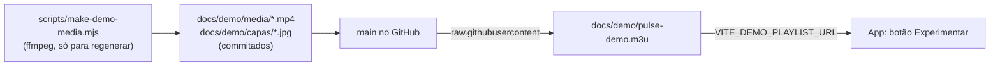

# RFC 0026: Lista de demonstração de uso geral
- **Status:** Fase 1 publicada na main e incluída no APK/AAB 2.2 (2026-11-06). Teste físico e capturas pendentes.
- **Autor:** Eduardo
- **Data:** 2026-11-06

## Contexto e problema
A lista de demonstração (`docs/demo/pulse-demo.m3u`) é o que o revisor da Play abre pelo botão "Experimentar com vídeos
de demonstração" (`src/views/Login.vue:35`, `:241`), e é o que vai nas capturas da loja. Hoje ela é fraca para isso:

- **Pouco conteúdo:** 4 itens em 2 grupos (3 filmes do Blender e 1 "canal" que é o Big Buck Bunny em HLS). A aba Ao vivo
  tem 1 item.
- **Sem capas:** o parser lê `tvg-logo` (`src/services/m3uParser.js:35`, `:80`, `:128`), mas nenhum item tem. Nas
  capturas aparece só a inicial do título.
- **Cara de app de IPTV:** a decisão do dono de 2026-11-05 é mostrar o app como reprodutor de uso geral (hotel,
  recepção, empresa, escola, igreja, academia), o que também reduz o risco de recusa na Play. A lista atual não mostra isso.
- **Dependência frágil:** 2 dos 4 links estão no Mux (`test-streams.mux.dev`), um serviço de teste de terceiros que
  pode sair do ar sem aviso (a Akamai e a Apple já saíram; ver `docs/demo/README.md`).
- **Aba Séries vazia:** a série só existe em servidor Xtream (`get_series` e `get_series_info`, em
  `catalogStore.js:24` e `xtreamApi.js:382`). M3U não tem séries, e o parser grava a seção vazia (`m3uParser.js:184`).

Links conferidos em 2026-11-06 (resposta HTTP): os 4 atuais respondem; Sintel (blender.org e archive.org) responde; NASA
TV `ntv2.akamaized.net` responde com vídeo 720p; `ntv1` dá 403.

## Decisões do dono (2026-11-06)
Atualização na execução: manter os dois HLS existentes (Big Buck Bunny e Tears of Steel), sem NASA.
Sintel entra como trailer oficial. O dono pediu a geração depois dos ajustes do site: APK/AAB 2.2 assinados no CI.
| Tema | Decisão | Como entra |
|---|---|---|
| Série | Quer uma série; se não der, pelo menos um aviso | **Fase 1:** aviso na aba Séries vazia. **Fase 2 (opcional):** série de verdade, por uma demonstração em Xtream no Worker |
| Streams de teste | Manter os dois endereços HLS atuais do Mux | Grupo "Eventos e transmissões de demonstração"; filmes usados para testar streaming |
| Capas | "O que fizer mais sentido" | Marca Pulse sóbria (grafite e limão), com o rótulo "Demonstração". Mantém a identidade e deixa claro que é conteúdo de teste |
| Som | Precisa ter som para os avaliadores | Todo vídeo próprio tem áudio audível, sintetizado por nós (sem licença de terceiros) |
| Idiomas | Os dois | Título do item em pt-BR; **capa e vídeo trazem pt-BR e inglês** (subtítulo em inglês). Título bilíngue no item não cabe: a grade do celular corta o nome em ~2 linhas |

## Objetivos / Não-objetivos
**Objetivos**
- Lista com grupos que representem usos gerais, **capa em todos os itens** e pelo menos 2 itens ao vivo.
- Vídeos próprios com **som**, e textos em pt-BR e inglês na capa e no vídeo.
- Conteúdo 100% livre ou nosso: nada de marca, logo ou nome real de empresa.
- Atualizar a lista sem APK novo: o app baixa a lista do endereço fixo do CI (`PULSE_DEMO_PLAYLIST_URL`).
- Reduzir a dependência de links de terceiros e ter um jeito simples de conferir todos antes de cada envio.
- Aba Séries com aviso claro (fase 1) e, se o dono confirmar depois, com uma série de verdade (fase 2).
- Servir de base para as capturas finais da Play (celular em pé e deitado, tablet e Android TV).

**Não-objetivos**
- Suporte a séries em listas M3U de usuários (agrupar `S01E01` etc.): é recurso do app, merece RFC própria.
- Voz falada nos vídeos (ver Perguntas em aberto).
- Mudar o botão "Experimentar" ou a tela de login.

## Proposta



### Conteúdo (fase 1)
Grupos e itens (nomes fictícios; "Exemplo" no lugar de qualquer marca):

| Grupo | Itens | Tipo |
|---|---|---|
| Hotel — Canais internos | Boas-vindas ao hóspede · Serviços do hotel · Cardápio do restaurante | nosso, 15 s |
| Recepção e espera | Bem-vindo à recepção · Avisos e horários | nosso, 15 s |
| Empresa — Treinamentos | Integração de novos colaboradores · Treinamento de segurança | nosso, 15 s |
| Escola e cursos | Aula 1 — Introdução · Aula 2 — Prática | nosso, 15 s |
| Academia | Treino em laço — Alongamento | nosso, 15 s |
| Eventos e transmissões de demonstração | Big Buck Bunny — teste HLS · Tears of Steel — teste HLS | streams de teste, de terceiros |
| Filmes de demonstração | Big Buck Bunny · Elephants Dream · Tears of Steel · Sintel — Trailer (Blender Foundation, CC BY, crédito no título) | de terceiros |

Total: **16 itens em 7 grupos** (10 vídeos próprios, 4 filmes, 2 ao vivo) e **16 capas**. As regras de licença continuam as
do `docs/demo/README.md`: só uso livre, crédito no nome, sem logo.

### Como o parser classifica (`m3uParser.js:102-108`)
- URL terminando em `.mp4` etc. é **filme** (aba Filmes), qualquer que seja o grupo. Por isso os vídeos próprios
  aparecem como categorias da aba Filmes.
- URL `.m3u8` ou `.ts` é **ao vivo** (aba Ao vivo). Os dois itens ao vivo ficam em grupo cujo nome não contém
  "filme", "série" nem "vod".
- O id do grupo vem do nome (`g_` + hash), então reordenar a lista não mexe no controle parental.

### Geração dos vídeos e capas (`scripts/make-demo-media.mjs`)
Script Node que chama o `ffmpeg` a partir de uma tabela `slug, grupo, título pt-BR, subtítulo en`. Só roda quando alguém
quiser regenerar; **os arquivos gerados são commitados**, então o CI não precisa de ffmpeg. Ao final o script confere com
`ffprobe` que cada arquivo tem 1 trilha de vídeo (720p, ~15 s) e **1 trilha de áudio**.
- **Imagem:** fundo grafite `#0B0F0C`, título em pt-BR e subtítulo em inglês em limão/claro, rótulo "Demonstração · Demo",
  um **relógio de tempo** (`drawtext` com `pts`) e uma barra que avança, para o vídeo não parecer travado.
  H.264 Main, yuv420p, `-movflags +faststart` (começa a tocar antes de baixar tudo).
- **Som:** acordes suaves em laço, sintetizados com os geradores de áudio do ffmpeg (nossos, sem direito de terceiros),
  volume baixo (cerca de −20 dB) com entrada e saída suaves. AAC estéreo 44,1 kHz, 96 kbps. Meta: menos de 1 MB por vídeo.
- **Capa:** JPG 600×900 (retrato, como as capas dos cartões), cartaz com título em pt-BR, subtítulo em inglês e o grupo,
  no mesmo estilo. Para os filmes do Blender, um quadro do próprio filme recortado em retrato, com o crédito no título.
  Para os 2 streams, um cartaz identificando o teste HLS e "Live test stream".

### Hospedagem
Arquivos em `docs/demo/media/` e `docs/demo/capas/`, servidos por `raw.githubusercontent.com/.../main/docs/demo/...`
(o mesmo lugar da lista). O cache do GitHub é de uns 5 minutos. A mídia gerada ocupa cerca de 3 MB no repositório.
**Plano B** se a etapa 0 falhar: pôr os arquivos em `server/license/public/demo/` e servir de
`pulseplayer.com.br/demo/`; o Worker já serve essa pasta como site (`wrangler.jsonc`, `assets.directory ./public`).
Exige deploy do Worker pelo dono.

### Arquivo da lista
`#EXTINF:-1 tvg-logo="https://raw.githubusercontent.com/.../docs/demo/capas/<slug>.jpg" group-title="<grupo>",<título>`
seguido da URL do `.mp4`. Todos os endereços em `https` (a Play pergunta sobre criptografia em trânsito).
Os filmes usam `.mp4` do archive.org/blender.org e o `.mov` oficial de Tears of Steel, com H.264/AAC.
Os dois HLS do Mux ficam na aba Ao vivo. A URL da lista **não muda**: a isenção da licença
(`licenseStore.js`, `isDemoSession`) vale pela URL exata.

### Aba Séries (fase 1: aviso)
Hoje uma lista M3U deixa a aba Séries com a mensagem genérica "Nenhum item encontrado nesta categoria.", que parece erro
(`CatalogBrowser.vue:615`). Quando a seção Séries estiver pronta, "Todos" estiver selecionado e não houver item, mostrar:

> **Esta lista não tem séries.**
> Listas no formato M3U trazem canais e filmes. As séries aparecem quando o servidor da lista oferece esse catálogo.

É mudança no app (entra no próximo AAB); a lista em si continua sem exigir APK. Teste em `tests/catalogBrowser.test.js`.

### Série de verdade (fase 2, opcional)
Para ter uma série no catálogo, a demonstração precisa falar Xtream, não M3U. O app já sabe fazer isso: um endereço com
`?username=demo&password=demo` entra como Xtream sem passar pela tela de login (`xtreamApi.js:562-604`, `credsFromUrl`).
Desenho:
- **Rota no Worker de licença**, isolada (não toca em D1): `GET /demo/xtream/player_api.php` responde por `action`
  (`get_live_*`, `get_vod_*`, `get_series_categories`, `get_series`, `get_series_info`) a partir de JSON estático em
  `server/license/public/demo/xtream/`. O formato das respostas já existe em `scripts/mock-xtream.mjs:312-316`.
- **Vídeos:** `/movie/demo/demo/<id>.mp4` e `/series/demo/demo/<id>.mp4` servem os arquivos de `public/demo/media/`;
  `/live/demo/demo/<id>.m3u8` redireciona para os dois HLS de teste atuais.
- **Uma série de exemplo:** "Série de demonstração" com 2 temporadas × 2 episódios (4 vídeos novos, mesmo gerador).
- **App:** `PULSE_DEMO_PLAYLIST_URL` passa a ser `https://pulseplayer.com.br/demo/xtream/get.php?username=demo&password=demo`
  (variável do CI) e `isDemoSession` passa a reconhecer essa demonstração (base do Worker + usuário `demo`).
- **Efeitos:** a demonstração deixa de depender do GitHub e passa a depender só do Worker, que o app já usa. Exige novo
  build (a variável entra no bundle) e deploy do Worker pelo dono. O `.m3u` continua no repositório como alternativa.

### Teste de guarda (`tests/demoList.test.js`)
Lê o `pulse-demo.m3u` real com `parseM3u` e confere: todo item tem `tvg-logo`; todo item próprio aponta para um arquivo
que **existe** em `docs/demo/media` e `docs/demo/capas`; todos os endereços são `https`; há 7 grupos e pelo menos 2
itens ao vivo; nenhum título contém "IPTV". A guarda lê o arquivo real, incluindo os endereços atuais dos dois HLS.

### Conferência dos links externos (antes de cada envio)
```bash
grep -E '^https' docs/demo/pulse-demo.m3u | while read u; do
  printf "%s " "$(echo "$u" | cut -c1-70)"; curl -s -L -o /dev/null -m 15 -r 0-1023 -w "%{http_code}\n" "$u"; done
```
Tudo precisa responder 200 ou 206. Vai para o `docs/demo/README.md` no lugar do "confira os endereços".

## Alternativas consideradas
- **Só trocar e acrescentar links de terceiros (sem vídeos próprios):** é rápido, mas não existe vídeo livre de
  hotel, recepção ou treinamento; ficaria só mais filme do Blender e não mostraria o uso geral. Descartada.
- **Vídeos próprios no Cloudflare R2 ou no Worker desde o início:** conteúdo e cabeçalhos mais controlados, mas exige
  conta, deploy e custo para ~10 MB. Fica como plano B.
- **Vídeos de bancos gratuitos (Pexels, Pixabay):** parecem mais reais, mas exigem conferir licença de cada um, e as
  licenças deles não são Creative Commons. Descartada pelo risco com a revisão da Play.
- **Suporte a séries em M3U no parser (agrupar `S01E01`):** ajudaria também listas reais, mas é recurso novo do app,
  com risco de regressão em toda lista M3U. Descartada aqui; merece RFC própria.
- **Voz falada nos vídeos:** o Windows tem vozes sintéticas em pt-BR, mas a licença de redistribuir o áudio gerado não foi
  conferida. Descartada por ora; o som é sintetizado por nós.
- **Título bilíngue em cada item:** a grade do celular corta o nome em ~2 linhas ("Última Par…"). O inglês vai na capa e
  no vídeo.

## Riscos e mitigação
| Risco | Mitigação |
|---|---|
| `raw.githubusercontent.com` entrega `.mp4`/`.m3u8` com cabeçalho ou Range inadequado e o vídeo não toca no celular ou na TV | **Etapa 0** testa um clipe com som no celular antes de gerar o resto; se falhar, plano B |
| GitHub limitar muitas requisições do mesmo IP | Poucos revisores e testadores; arquivos pequenos; plano B |
| Mux sair do ar | Conferir os dois HLS antes de cada envio; os filmes têm endereços separados e os dez vídeos próprios continuam disponíveis |
| Vídeo próprio parecer travado | Relógio e barra animados no vídeo |
| Som alto ou irritante | Volume baixo, entrada e saída suaves; ouvir no celular e na TV na etapa 5 |
| Repositório crescer ao regenerar mídia | Gerar uma vez e só recommitar quando o conteúdo mudar |
| TV antiga (Chromium 63) não tocar H.264 Main 720p com AAC | É o perfil mais comum nessas TVs; testar na Android TV |
| Sintel completo (archive.org) demorar para começar | Medir o tempo até o primeiro quadro no celular; usar o trailer de `download.blender.org` se passar de ~10 s |
| Revisor ver marca de terceiro | Nomes "Exemplo", nenhum logo, crédito nos itens do Blender; teste de guarda |
| Fase 2 mexer no Worker de produção (licença e pagamentos) | Rota isolada em `/demo/xtream`, sem acesso ao D1, com teste próprio; deploy só pelo dono, depois da fase 1 aprovada |
| Fase 2 mudar a isenção da licença da demonstração | Teste em `tests/licenseClient.test.js` com a demonstração Xtream e com outra lista Xtream que continua bloqueando |

## Plano de implementação
Cada etapa é pequena e termina com algo verificável. **Fase 1** destrava a Play; a **fase 2** só segue se o dono confirmar
depois de ver a fase 1 no aparelho.

**Fase 1 — lista nova com capas, som e aviso**
0. **Teste de hospedagem.** Gerar 1 vídeo de teste **com som**, subir numa branch e tocar no celular pelo campo de
   endereço do login (a lista aceita a URL de uma playlist no primeiro campo, sem mexer no APK). Anotar `Content-Type`,
   suporte a Range, tempo até o primeiro quadro e se o áudio toca. **Decide:** GitHub (padrão) ou plano B.
1. **Gerador e mídia.** `scripts/make-demo-media.mjs`, os 10 vídeos próprios e as 16 capas (pt-BR e inglês), commitados.
   O script confere vídeo, áudio, duração e peso com `ffprobe`.
2. **Nova lista.** `docs/demo/pulse-demo.m3u` com os 7 grupos, `tvg-logo`, os dois HLS existentes e Sintel — Trailer.
3. **Aviso da aba Séries** em `CatalogBrowser.vue` e teste em `tests/catalogBrowser.test.js`.
4. **Guarda e documentação.** `tests/demoList.test.js`; `docs/demo/README.md` (tabela de itens, comando de conferência);
   `docs/PLANO.md`. `npm test`, `npm run lint` e `npm run build` verdes.
5. **Teste antes de juntar.** No celular, digitar no login o endereço da lista na branch: os 7 grupos aparecem com capa,
   cada vídeo toca **com som**, os dois HLS tocam, o aviso aparece na aba Séries, o controle parental bloqueia um grupo e a
   isenção da licença continua valendo.
6. **PR e merge.** Depois de juntar, o botão "Experimentar" de qualquer build já mostra a lista nova (cache de ~5 min). O
   aviso da aba Séries entra no próximo AAB, que ainda não foi enviado à Play.
7. **Capturas finais da Play.** Gravar celular em pé e deitado, tablet e Android TV com essa lista, incluindo o
   controle parental e o player tocando (item aberto no `docs/PLANO.md`, seção 2).

**Fase 2 — série de verdade (opcional)**
8. **Mídia da série.** 4 episódios e a capa, com o mesmo gerador.
9. **Rota de demonstração no Worker.** `server/license/license-demo.mjs`, JSON em `server/license/public/demo/xtream/` e
   teste `tests/licenseDemo.test.js` (uma resposta por `action`, redirecionamentos de vídeo, nada acessa o D1).
10. **App.** `isDemoSession` reconhece a demonstração Xtream; variável `PULSE_DEMO_PLAYLIST_URL` do CI muda para o
    endereço do Worker; teste de isenção em `tests/licenseClient.test.js`.
11. **Deploy e conferência.** O dono publica o Worker (`npm run license:deploy`); teste no celular (Séries com 1 série,
    2 temporadas, episódios tocando); novo AAB (subir o `versionCode` se o atual já tiver sido enviado).

## Verificação da implementação local (2026-11-06)
- Dez vídeos e dezesseis capas gerados. `ffprobe` confirma H.264 Main 720p, áudio AAC estéreo e 15 s, abaixo de 1 MB por vídeo.
- Áudio medido com `volumedetect` no clipe de boas-vindas: média −21,6 dB e pico −13,5 dB, com fades.
- Capas de filmes usam quadros reais, recortados e com crédito. Sintel usa o trailer oficial de 7,3 MB.
- Os dois HLS atuais foram abertos pelo `ffprobe` com trilhas de vídeo e áudio. Tears of Steel exige
  `-allowed_extensions ALL -extension_picky 0` nessa ferramenta por causa das legendas WebVTT com extensão `.mp4`.
- Mídia publicada na main em `d4ca008`. Os 26 arquivos responderam 200/206. O MP4 tem Range e tipo
  `application/octet-stream`; o Chromium reproduziu o clipe de 15 s/720p diretamente do GitHub.
- O aviso de Séries e a isenção da demonstração estão no APK/AAB 2.2. Testes físicos continuam pendentes.

## Perguntas em aberto
1. **Fase 2:** seguir depois de ver a fase 1 no aparelho? (Decisão do dono; não bloqueia a fase 1.)
2. **Voz falada:** querer narração nos vídeos exige conferir a licença das vozes. Padrão: não.
3. **Texto do aviso da aba Séries:** aprovar o texto acima ou ajustar.
